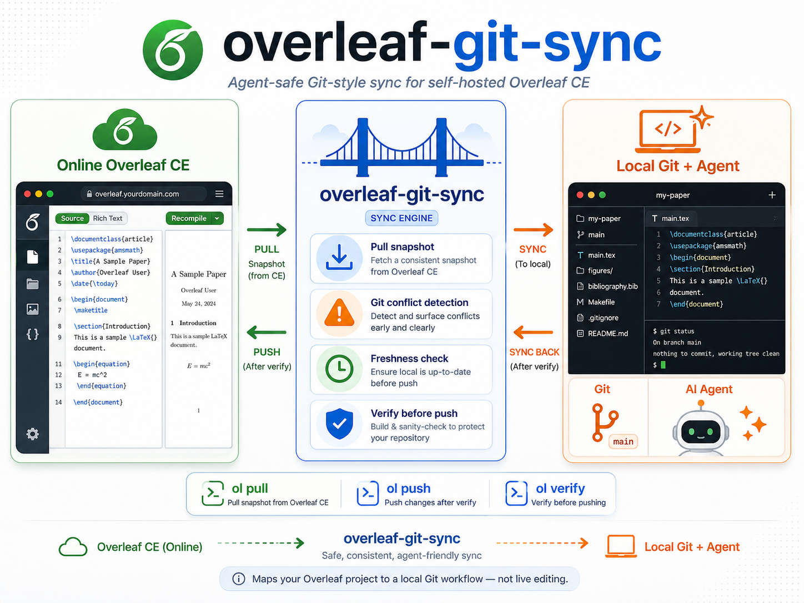

# overleaf-git-sync

Map an online Overleaf project to a local Git-backed working repository.



中文文档: [README.zh-CN.md](README.zh-CN.md)

Use local Git as the safety layer between your editor and Overleaf. The tool
treats Overleaf as a remote project snapshot, imports that snapshot into a
managed local Git branch, lets Git detect conflicts, and only writes back after
a freshness check and verification pass.

This is not a replacement for the official Overleaf Git integration. It is an
MVP tool for working on an online Overleaf project through a normal local Git
repository.

## Development Log

Current development versions: CLI `0.2.2`, VS Code extension `0.2.1`.

| Date | Version / milestone | Important changes |
| --- | --- | --- |
| 2026-04-29 | `0.1.0` initial CLI | Added session authentication, project initialization, pull, push, status, verify, and Git-based conflict handling. |
| 2026-05 to 2026-06 | Reliability iterations | Fixed folder and deletion handling, aligned remote-branch metadata, preserved ignored files, and improved snapshot staging. |
| 2026-07-10 | `0.2.0` safety overhaul | Added remote concurrency guards, versioned text OT updates, durable push journals and recovery, safe snapshot imports, path/content validation, atomic credential storage, and live fault-injection coverage. |
| 2026-07-11 | CLI integration API | Added `ol status --json`, working-tree details, and the latest successful sync timestamp for editor integrations. |
| 2026-07-11 | VS Code GUI | Added a native Activity Bar view with live local status, changed-file lists, Pull, Preview Push, Push, Verify, Recover, and last-sync time. |
| 2026-07-11 | Installation cleanup | Added one-time global installation through `uv tool`, removing the need to activate the development virtual environment for normal use. |

## Current MVP Status

Important commands:

- `ol auth login` — save a logged-in Overleaf session in `.ol-sync/session.json`
- `ol init` — create local sync metadata and connect the current folder to an
  Overleaf project
- `ol pull` — import the latest remote snapshot and stage it for review
- `ol push` — push committed local changes back to Overleaf after a freshness
  check
- `ol push --fast` — skip merging the freshness snapshot while still checking
  the live remote baseline before every write
- `ol status` — show the current branch, sync metadata, and local changes
- `ol verify` — download the latest remote snapshot and compare it with the
  local tree
- `ol recover` — import an interrupted push state back through Git

## Installation

Install the tool once with `uv` as a global command. This keeps the tool in an
isolated environment while making `ol` available from any Overleaf project
directory without activating the repository's development environment.

From this repository root:

```bash
uv tool install --editable .
uv tool update-shell  # only needed if ~/.local/bin is not already on PATH
ol --version
```

Open a new terminal after `uv tool update-shell`. You do **not** need to stay in
this repository directory or activate `.venv`. A typical flow is:

```bash
cd ~/papers/my-paper
ol auth login --host http://localhost --email you@example.com
```

Because this checkout is installed with `--editable`, source-code updates take
effect immediately. Run `uv tool uninstall overleaf-git-sync` to remove the
global command.

## VS Code Extension

The repository also includes a native VS Code interface under
[`vscode-extension/`](vscode-extension/). It adds an **Overleaf** icon to the
Activity Bar and provides a Git-style **Sync Status** view instead of requiring
normal operations to be launched from the Command Palette.

For every initialized project, the view shows:

- the current branch and clean or dirty working-tree state;
- uncommitted files and committed file operations waiting to be pushed;
- Git conflicts and interrupted-push recovery state;
- the local date and time of the latest successful sync;
- explicit remote freshness state.

The view toolbar and project rows provide buttons for **Refresh**, **Pull**,
**Preview Push**, **Push**, **Verify**, and **Recover**. Clicking a changed file
opens it in the editor. Push always runs a dry-run preview first and requires
confirmation; the extension never pushes automatically on save.

The extension delegates all authentication, Git conflict handling, remote
checks, journaling, and verification to the `ol` CLI. Install the CLI first as
described above, then build and install the current VSIX:

```bash
cd vscode-extension
npm install
npm run package
code --install-extension overleaf-git-sync-0.2.1.vsix --force
```

Alternatively, run **Extensions: Install from VSIX...** in VS Code and select
the generated file. Reload the VS Code window, open a local folder containing
`.ol-sync/config.toml`, and click the Overleaf icon. When no initialized project
is found, the view offers **Initialize Project** and **Log In** links.

On macOS, a VS Code process launched from the Dock may not inherit the shell
`PATH`. In that case, configure the stable executable installed by `uv tool`:

```json
{
  "overleafGitSync.executable": "/Users/you/.local/bin/ol"
}
```

The sidebar refreshes local Git and file state on events and every five seconds
by default. It deliberately does not poll Overleaf in the background: **No
local changes** does not prove the remote project is current. Use **Verify** or
**Pull** when an actual remote check is required.

## End-to-End Workflow

This is the recommended full flow from an empty local folder to a successful
push back to Overleaf.

### 1. Log in to Overleaf

Run login inside the local project directory. The session is stored in
`.ol-sync/session.json`, and `ol init` will reuse the host from that saved
session, so you usually do not need to pass `--host` again.

For local Docker or self-hosted deployments, password login is usually the
simplest option:

```bash
mkdir -p ~/papers/my-paper
cd ~/papers/my-paper
ol auth login --host http://localhost --email you@example.com
```

For the official Overleaf site (`https://www.overleaf.com/`), browser-cookie
login is recommended. The same method works when a self-hosted deployment
blocks password login with SSO, captcha, or another local policy.

To get the Cookie header:

1. Log in to Overleaf in your browser and open the project.
2. Open the browser developer tools, select the **Network** tab, and reload the
   page.
3. Select a request sent to the Overleaf host. Under **Request Headers**, copy
   the complete value after `Cookie:`. Alternatively, use **Application** (or
   **Storage**) > **Cookies** and copy the relevant `name=value` pairs.

Cookie names vary by deployment. Self-hosted Community Edition commonly uses
`sharelatex.sid`, while the official site commonly uses
`overleaf_session2`. Pass the copied value through standard input:

```bash
# Self-hosted Community Edition (common cookie name)
printf '%s' 'sharelatex.sid=...' | \
  ol auth login --host https://overleaf.example.com --cookie-stdin

# Official Overleaf
printf '%s' 'overleaf_session2=...' | \
  ol auth login --host https://www.overleaf.com --cookie-stdin
```

Prefer `--cookie-stdin`, `--password-stdin`, or the interactive password prompt.
Command-line secret arguments remain for compatibility but may be visible in
shell history or process listings. A session cookie grants access to your
account: never post it in an issue, paste it into logs, or commit
`.ol-sync/session.json`.

Confirm that the saved session works before continuing:

```bash
ol auth status
```

### 2. Initialize the local sync repository

Open the project in Overleaf and look at its URL:

```text
https://www.overleaf.com/project/67ab12cd34ef567890abcdef
```

The segment after `/project/` (and before any following `/`, `?`, or `#`) is the
project ID. In this example it is `67ab12cd34ef567890abcdef`. `--project-name`
is only a descriptive local name; it does not have to exactly match the title
shown by Overleaf.

```bash
ol init --project-id 67ab12cd34ef567890abcdef --project-name my-paper
```

This step:

- creates `.ol-sync/config.toml`
- creates or updates `.gitignore`
- runs `git init` only when the current directory does not already have its own
  `.git`
- downloads the initial remote snapshot
- creates the managed `overleaf-remote` branch

If `.ol-sync/config.toml` already exists, `ol init` overwrites it by default.
Use `--keep-config` to keep the existing config file.

In a non-empty non-Git directory, `--force` now creates a local safety commit
before importing Overleaf. Symbolic links, submodules, nested Git repositories,
and a managed branch checked out in another worktree are rejected.

### 3. Pull the latest remote snapshot

Always pull before editing:

```bash
ol pull
git diff --cached
git commit -m "overleaf: import latest remote snapshot"
```

`ol pull` stages remote changes instead of auto-creating a merge commit. If the
remote snapshot is already fully merged, it exits without staging anything.

### 4. Edit locally and commit

```bash
$EDITOR main.tex
git diff
git add -A
git commit -m "agent: revise introduction"
```

### 5. Push back to Overleaf

Preview the plan first:

```bash
ol push --dry-run
```

Dry-run is local-only: it plans from the saved `overleaf-remote` branch and does
not contact Overleaf or stage freshness changes.

Then apply it:

```bash
ol push
```

`ol push` performs a freshness pull and checks the full remote tree again before
every remote operation. Progress is stored in `.ol-sync/push_journal.json`. If a
request is interrupted, run `ol recover` to import the current remote state
through Git before another push.

If you are the only person editing the project and you know your local
`overleaf-remote` branch is already fresh, you can skip that pre-push refresh:

```bash
ol push --fast
```

`--fast` skips importing and merging the freshness snapshot, but still requires
the live remote tree to match the saved baseline before every write and still
performs post-push verification.

## Concurrency boundary

The HTTP backend checks the complete remote snapshot immediately before every
write and again after the push. Existing editable documents are updated through
Overleaf's `joinDoc` / `applyOtUpdate` channel using the document version and a
minimal text operation; the backend then downloads that document and requires
an exact content match. Unsupported OT types are rejected instead of falling
back to an unversioned replacement. Legacy `sharejs-text-ot` also cannot safely
insert non-BMP Unicode characters; those updates are rejected before mutation
because the server would replace UTF-16 surrogate units with `U+FFFD`.

Overleaf CE upload, rename, delete, and folder routes do not expose an atomic
conditional-version parameter, so a narrow final check-to-write race remains
for binary, creation, and structural operations. Avoid changing those same
paths online during the few seconds of a push. Ambiguous replacement failures
are reconciled from a fresh entity tree, and the push journal plus final snapshot
verification prevent them from being silently marked successful.

PDF, BBL, and IST files are no longer ignored by default because they may be
source assets. Sync ignore rules are explicit and no longer approximate
`.gitignore`; tracked files remain syncable even if a later Git ignore rule
matches them.

### 6. Check status or verify

```bash
ol status
ol verify
```

## Configuration

Example `.ol-sync/config.toml`:

```toml
[project]
host = "http://localhost"
project_id = "YOUR_PROJECT_ID"
project_name = "my-paper"

[backend]
type = "http"

[auth]
session_file = ".ol-sync/session.json"
```

## Using with Agents

If you want a coding agent to help revise the paper, you can also give the
agent this repository's `SKILL.md` file. It explains the safe `ol` workflow,
including when to run `ol pull`, how to review staged remote changes, and how
to push back without overwriting newer Overleaf edits.

## Development

If you are developing `overleaf-git-sync` itself, install the development
dependencies as well:

```bash
uv venv --python 3.13
uv pip install -e ".[dev]"
.venv/bin/python -m pytest
.venv/bin/ruff check .
.venv/bin/ol --help
```
