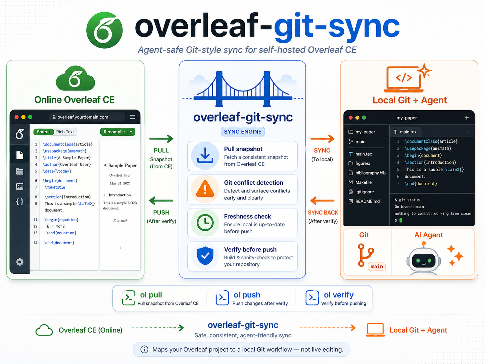

# overleaf-git-sync

把在线 Overleaf 项目映射成一个本地 Git 工作仓库。



这个项目把本地 Git 当作本地编辑器和 Overleaf 之间的安全层：

- 先拉取远端快照到本地
- 再在本地 Git 仓库里修改、提交
- 推送前再次拉取远端最新状态
- 如果 Git 发现冲突，就停止，不静默覆盖远端修改

它不是 Overleaf 官方 Git 集成的替代品，也不实现 Git 协议服务器。

## 开发日志

当前开发版本：CLI `0.2.2`，VS Code 插件 `0.2.1`。

| 日期 | 版本 / 节点 | 重要更新 |
| --- | --- | --- |
| 2026-04-29 | `0.1.0` CLI 初版 | 实现 Session 认证、项目初始化、Pull、Push、Status、Verify 和基于 Git 的冲突处理。 |
| 2026-05 至 2026-06 | 可靠性迭代 | 修复文件夹与删除操作、校准远端分支元数据、保护忽略文件并改进快照暂存。 |
| 2026-07-10 | `0.2.0` 安全性重构 | 加入远端并发保护、带版本的文本 OT 更新、持久化 Push 日志与恢复、安全快照导入、路径和内容校验、凭据原子写入以及实时故障注入测试。 |
| 2026-07-11 | CLI 集成接口 | 加入 `ol status --json`、工作区文件详情和最近成功同步时间，供编辑器稳定读取。 |
| 2026-07-11 | VS Code GUI | 加入原生 Activity Bar 面板，实时显示本地状态和变更文件，并提供 Pull、Preview Push、Push、Verify、Recover 和最近同步时间。 |
| 2026-07-11 | 安装体验优化 | 支持通过 `uv tool` 一次性全局安装，日常使用不再需要激活开发虚拟环境。 |

## 当前提供的功能

- `ol auth login`：保存一个已登录的 Overleaf 会话到 `.ol-sync/session.json`
- `ol init`：初始化当前目录的同步配置，并绑定到一个 Overleaf 项目
- `ol pull`：导入远端最新快照，并把变更放到暂存区等待确认
- `ol push`：先做 freshness check，再把已提交的本地改动推回 Overleaf
- `ol push --fast`：跳过远端快照的 Git 合并，但写入前仍检查远端基线
- `ol status`：查看当前分支、同步元数据和本地改动概览
- `ol verify`：下载远端最新快照，并和本地目录做逐文件对比
- `ol recover`：把中断 Push 的远端状态重新导入 Git

## 安装

使用 `uv` 将工具一次性安装成全局命令。`uv` 仍会为工具维护隔离环境，但之后可以在
**任意** Overleaf 项目目录直接使用 `ol`，不需要激活本仓库的开发虚拟环境。

在本仓库根目录执行：

```bash
uv tool install --editable .
uv tool update-shell  # 仅当 ~/.local/bin 尚未加入 PATH 时需要
ol --version
```

执行 `uv tool update-shell` 后请打开一个新终端。此后不需要停留在本仓库目录，也不
需要激活 `.venv`。典型用法是：

```bash
cd ~/papers/my-paper
ol auth login --host http://localhost --email you@example.com
```

这里使用 `--editable` 安装，因此仓库源码更新后会立即生效。需要移除全局命令时执行
`uv tool uninstall overleaf-git-sync`。

## VS Code 插件

仓库的 [`vscode-extension/`](vscode-extension/) 目录还提供了原生 VS Code 界面。安装后
左侧 Activity Bar 会出现 **Overleaf** 图标，其中的 **Sync Status** 面板提供类似 Git
GUI 的操作方式，日常同步不再需要从命令面板启动。

对于每个已经初始化的项目，面板会显示：

- 当前 Git 分支以及工作区是否干净；
- 尚未提交的文件和已经提交、等待 Push 的文件操作；
- Git 合并冲突和中断 Push 的恢复状态；
- 最近一次成功同步的本地日期和时间；
- 明确的远端 freshness 状态。

面板顶部和项目行提供 **Refresh**、**Pull**、**Preview Push**、**Push**、**Verify** 和
**Recover** 按钮。点击变更文件可以直接在编辑器中打开。正式 Push 总会先执行 dry-run
预览并要求确认；插件不会在保存文件时自动 Push。

插件不会另行实现一套同步逻辑，认证、Git 冲突处理、远端检查、操作日志和最终校验都
交给 `ol` CLI。请先按上一节安装 CLI，然后构建并安装当前 VSIX：

```bash
cd vscode-extension
npm install
npm run package
code --install-extension overleaf-git-sync-0.2.1.vsix --force
```

也可以在 VS Code 中执行 **Extensions: Install from VSIX...**，选择生成的安装包。重载
VS Code 窗口后，打开包含 `.ol-sync/config.toml` 的本地目录，再点击左侧 Overleaf
图标。如果尚未发现初始化项目，面板会提供 **Initialize Project** 和 **Log In** 入口。

macOS 从 Dock 启动的 VS Code 不一定会继承 shell 的 `PATH`。这种情况下，应将插件
指向 `uv tool` 安装的稳定命令，而不是仓库里的 `.venv`：

```json
{
  "overleafGitSync.executable": "/Users/you/.local/bin/ol"
}
```

侧栏会在 Git 或文件发生变化时刷新本地状态，默认还会每 5 秒刷新一次。它不会在后台
持续轮询 Overleaf：**No local changes** 只代表本地没有改动，不能证明远端仍是最新。
需要真实检查远端时，请使用 **Verify** 或 **Pull**。

## 完整上手流程

下面演示一遍从空文件夹开始，到登录、初始化、本地修改、提交、推送的完整过程。

### 1. 登录 Overleaf

先在本地项目目录里登录。登录后，session 会保存到 `.ol-sync/session.json`，后续
`ol init` 会直接复用这里面的 host，所以通常不需要再传 `--host`。

如果你用的是本地 Docker 部署或自托管 Overleaf，通常直接用密码登录最省事：

```bash
mkdir -p ~/papers/my-paper
cd ~/papers/my-paper
ol auth login --host http://localhost --email you@example.com
```

如果你用的是官方 Overleaf（`https://www.overleaf.com/`），目前更推荐复用浏览器
Cookie。自托管部署因 SSO、验证码或本地策略无法使用密码登录时，也可以使用此方法。

获取 Cookie header 的步骤如下：

1. 在浏览器中登录 Overleaf 并打开要同步的项目。
2. 打开浏览器开发者工具，进入 **Network（网络）** 面板，然后刷新页面。
3. 选择一个发往当前 Overleaf 域名的请求，在 **Request Headers（请求标头）** 中找到
   `Cookie:`，复制它后面的完整内容。也可以进入 **Application（应用）** 或
   **Storage（存储）** > **Cookies**，复制相关的 `name=value`。

Cookie 名称会随部署方式变化：自托管 Community Edition 常见的是
`sharelatex.sid`，官方站点常见的是 `overleaf_session2`。通过标准输入传入复制的值：

```bash
# 自托管 Community Edition（常见 Cookie 名称）
printf '%s' 'sharelatex.sid=...' | \
  ol auth login --host https://overleaf.example.com --cookie-stdin

# Overleaf 官方站点
printf '%s' 'overleaf_session2=...' | \
  ol auth login --host https://www.overleaf.com --cookie-stdin
```

`--cookie` 和 `--password` 仍为兼容旧脚本而保留，但可能把凭据暴露在 shell history
或进程列表里；新脚本应使用 stdin 参数或交互式密码提示。Session Cookie 可以访问你的
账号，请勿将它发布到 issue、粘贴进日志，或提交 `.ol-sync/session.json`。

继续之前，先确认保存的会话有效：

```bash
ol auth status
```

### 2. 初始化本地同步仓库

在 Overleaf 中打开要同步的项目，查看浏览器地址栏，例如：

```text
https://www.overleaf.com/project/67ab12cd34ef567890abcdef
```

`/project/` 后面的部分（到下一个 `/`、`?` 或 `#` 之前）就是 project ID；上例中为
`67ab12cd34ef567890abcdef`。`--project-name` 只是本地使用的描述性名称，不必与
Overleaf 中显示的项目标题完全一致。

```bash
ol init --project-id 67ab12cd34ef567890abcdef --project-name my-paper
```

这一步会：

- 创建 `.ol-sync/config.toml`
- 创建或补充 `.gitignore`
- 如果当前文件夹**还没有自己的 `.git`**，自动执行 `git init`
- 下载远端项目初始快照
- 建立 `overleaf-remote` 分支并合并到本地工作分支

如果当前目录已经有 `.ol-sync/config.toml`，`ol init` 默认会覆盖它；传
`--keep-config` 可以保留原配置。

非 Git 目录不是空目录时仍需传 `--force`，但工具现在会先创建
`local: pre-sync safety snapshot` 提交，不再直接删除原有文件。重新绑定到另一个
Overleaf 项目也必须显式传 `--force`。符号链接、submodule、嵌套 Git 仓库以及在其他
worktree 中检出的 `overleaf-remote` 分支会被拒绝。

### 3. 拉取远端最新修改

在开始编辑前，先拉一次：

```bash
ol pull
```

`ol pull` 不会直接替你生成 merge commit。它会把远端变更放到暂存区，你确认后自己提交：

```bash
git diff --cached
git commit -m "overleaf: import latest remote snapshot"
```

如果没有新的远端修改，`ol pull` 会直接结束。

### 4. 本地修改并提交

现在可以在本地编辑论文文件，比如：

```bash
$EDITOR main.tex
git diff
git add -A
git commit -m "agent: revise introduction"
```

### 5. 推送回 Overleaf

先看推送计划：

```bash
ol push --dry-run
```

`--dry-run` 只使用本地保存的 `overleaf-remote` 快照生成计划，不访问 Overleaf，也不
执行 freshness pull。

确认没问题后正式推送：

```bash
ol push
```

`ol push` 会先自动做 freshness pull，并在每个远端操作之前再次下载和核对远端树。
每一步都会记录在 `.ol-sync/push_journal.json`。如果远端请求中断，新的 Push 会被阻止，
先运行：

```bash
ol recover
```

恢复命令会把当前远端状态导入 `overleaf-remote` 并交给 Git 合并；若有冲突，解决并提交
后再 Push。

如果你明确知道当前项目只有你一个人在改，并且本地的 `overleaf-remote` 已经是最新的，
可以用更快的模式直接跳过 freshness pull：

```bash
ol push --fast
```

`--fast` 只跳过 freshness snapshot 的 Git 导入/合并，仍要求实时远端树与本地保存的
远端基线一致，并保留写入后验证。

### 6. 查看状态或校验

查看当前同步状态：

```bash
ol status
```

校验本地和远端是否一致：

```bash
ol verify
```

## 配置文件示例

初始化后会生成 `.ol-sync/config.toml`，大致如下：

```toml
[project]
host = "http://localhost"
project_id = "YOUR_PROJECT_ID"
project_name = "my-paper"

[backend]
type = "http"

[auth]
session_file = ".ol-sync/session.json"
```

## 配合 Agent 使用

如果你希望本地 coding agent 帮你一起修改论文，也可以把本仓库里的 `SKILL.md`
 一并提供给 agent。这个文件专门说明了怎样安全地使用 `ol` 命令，包括什么时候先
 `ol pull`、怎样处理暂存区里的远端变更、以及怎样在不覆盖 Overleaf 新修改的前提下
 推送回去。

## 安全原则

- 不直接修改 Docker volume、MongoDB、Redis 或 Overleaf 编译缓存
- 不做字符级实时同步
- 不绕过 Git 做自定义合并
- 推送前必须重新拉取远端快照
- 有冲突就停
- 写回后必须重新验证远端结果

HTTP 后端使用 Overleaf CE 的网页内部路由。工具会在每个写操作前检查完整远端快照，
并在最后再次验证。更新已有可编辑文档时，工具会通过 Overleaf 的 `joinDoc` /
`applyOtUpdate` 通道提交带文档版本号的最小文本操作，并重新下载该文档进行精确校验；
遇到尚未支持的 OT 类型会停止，而不会退回到无版本覆盖。
旧版 `sharejs-text-ot` 也无法安全插入非 BMP Unicode 字符（例如许多 emoji 和数学字母）；
工具会在远端写入前拒绝这类更新，避免服务端把 UTF-16 代理项替换成 `U+FFFD`。

上传、重命名、删除和目录路由仍没有原子版本条件，因此二进制文件、新建文件和目录操作
存在一个很窄的“检查请求到写请求”窗口。重要协作项目应避免在 Push 的几秒内同时在线
修改这些路径。响应丢失时，文件替换会重新读取远端实体树进行补偿；push journal 和最终
快照校验保证这类异常不会被静默标记为成功。

默认忽略规则不再排除全部 PDF、BBL 和 IST 文件，因为它们可能是论文源素材。同步忽略
规则也不再近似复用 `.gitignore`；已经被 Git 跟踪的文件仍会同步。需要排除的内容应写入
`.ol-sync/config.toml` 的 `[ignore]`。

最高优先级是不让陈旧的本地输出静默覆盖 Overleaf 上的新修改。

## 开发这个工具时才需要的命令

如果你是在开发 `overleaf-git-sync` 本身，而不是只把它拿来同步论文，可以再安装
开发依赖：

```bash
uv venv --python 3.13
uv pip install -e ".[dev]"
.venv/bin/python -m pytest
.venv/bin/ruff check .
.venv/bin/ol --help
```
